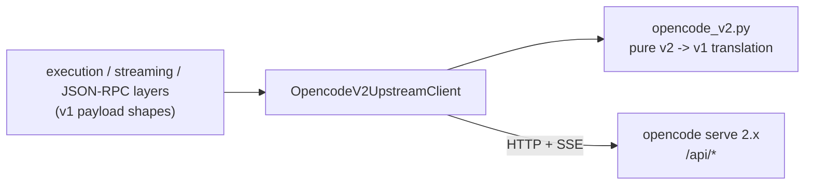

# OpenCode v2 Support

This fork talks to OpenCode 2.x (`opencode serve` 2.1.0 and later) through the `/api/*`
HTTP API. The A2A surface is unchanged: same environment variables, same Agent Card, same
JSON-RPC and REST methods, same extensions, same outbound `a2a_call` behaviour.

## Selecting the upstream API

| `OPENCODE_API_VERSION` | Upstream | Client |
|---|---|---|
| `v2` (default) | OpenCode 2.x | `OpencodeV2UpstreamClient` (`opencode_upstream_client_v2.py`) |
| `v1` | OpenCode 1.x | `OpencodeUpstreamClient` (upstream client, unchanged) |

`OPENCODE_AUTH_PASSWORD` / `OPENCODE_AUTH_USERNAME` still send HTTP Basic auth; OpenCode 2.x
`serve` honours `OPENCODE_SERVER_PASSWORD`.

## Design

- The v2 client keeps the v1 client's method signatures and returns v1-shaped payloads, so
  every consumer above it is unchanged.
- All shape translation lives in `opencode_v2.py` as pure functions plus one stateful
  event translator; it is unit-tested against payloads captured from OpenCode 2.1.0.

## Mapping

| Operation | OpenCode 1.x | OpenCode 2.x |
|---|---|---|
| Working directory | `?directory=` on every call | `location.directory` at session creation; `location[directory]` query on catalog calls |
| Create session | `POST /session` | `POST /api/session` with `location`, `agent` |
| Send message (blocking) | `POST /session/{id}/message` | `POST /api/session/{id}/prompt`, then `POST /api/experimental/session/{id}/wait` until an `idle` message follows the prompt; the turn's assistant messages fold into one v1 message |
| Prompt async | `POST /session/{id}/prompt_async` | `POST /api/session/{id}/prompt` |
| Model per request | `model` in message body | `POST /api/session/{id}/model` before the turn; reset to the default model on the next turn without an override |
| Agent | `agent` in message body | `agent` at session creation, `POST /api/session/{id}/agent` |
| `OPENCODE_SYSTEM` | `system` in message body | session instruction entry `opencode-a2a-system` (`PUT /api/experimental/session/{id}/instructions/entries/{key}`) |
| `OPENCODE_VARIANT` | `variant` in message body | `variant` of the session `Model.Ref` |
| Events | `GET /event` | `GET /api/event`, translated as below |
| Abort | `POST /session/{id}/abort` | `POST /api/session/{id}/interrupt` |
| Summarize | `POST /session/{id}/summarize` | `POST /api/session/{id}/compact` |
| Revert / unrevert | `POST /session/{id}/revert` / `unrevert` | `POST /api/session/{id}/revert/stage` / `DELETE /api/session/{id}/revert` |
| Fork | `POST /session/{id}/fork` `messageID` | `POST /api/session/{id}/fork` `before` |
| Command / shell | synchronous message result | `POST .../command` / `.../shell`, then wait for the turn |
| Permission reply | `POST /permission/{id}/reply` | `POST /api/session/{sid}/permission/{id}/reply` (`decision`) |
| Question reply / reject | `POST /question/{id}/reply` / `reject` | `POST /api/session/{sid}/form/{id}/reply` / `DELETE /api/session/{sid}/form/{id}` |
| Provider catalog | `GET /provider` | `GET /api/provider` + `/api/model` + `/api/model/default` |
| Projects | `GET /project`, `/project/current` | `GET /api/project`, `/api/location` |
| Worktrees | `/experimental/worktree` | `/api/worktree` with the current `projectID` |

Session-scoped interrupt replies need the session id; the adapter takes it from its
interrupt registry and falls back to `GET /api/permission/request` or `GET /api/form`.

### Events

| OpenCode 2.x event | Emitted as (v1) |
|---|---|
| `session.text.started` / `.delta` / `.ended` | `message.part.updated` / `message.part.delta` / `message.part.updated` (text part) |
| `session.reasoning.*` | same, reasoning part |
| `session.tool.input.started`, `.called`, `.success`, `.failed` | `message.part.updated` tool part: `pending`, `running`, `completed`, `error` |
| `session.step.started` / `.ended` / `.failed` | `step-start` / `step-finish` part (token usage) |
| `session.execution.succeeded` | `session.idle` |
| `session.execution.failed` | `session.error` |
| `session.execution.interrupted` | `session.error` (`MessageAbortedError`) |
| `permission.asked` / `.replied` | `permission.asked` / `.replied` (`action` -> `permission`, `resources` -> `patterns`) |
| `form.created` / `.replied` / `.cancelled` | `question.asked` / `.replied` / `.rejected` |

Text and reasoning part ids are `<assistantMessageID>:<text|reasoning>:<ordinal>`; tool part
ids are the tool call id.

## Degraded features

| Feature | Behaviour on OpenCode 2.x |
|---|---|
| `opencode.sessions.todo` | returns an empty list: v2 has no session todo list |
| `opencode.sessions.share` / `unshare` | upstream error, HTTP 501: sharing was removed |
| `opencode.workspaces.*` | upstream error, HTTP 501: experimental workspaces were removed |
| `opencode.worktrees.reset` | upstream error, HTTP 501: no v2 counterpart |
| Directory override on an existing session | ignored: the location is fixed when the session is created |
| `opencode.sessions.shell` `agent` / `model` | ignored: v2 shell commands run outside an agent |
| Summarize `providerID` / `modelID` | ignored: v2 compacts with the session model |
| Question answers | mapped positionally onto the form's visible fields; booleans accept `true`/`yes`/`1` |
| `a2a_call` | unchanged: handled when a response carries a tool part in state `calling`, which OpenCode (1.x and 2.x) does not emit natively |
